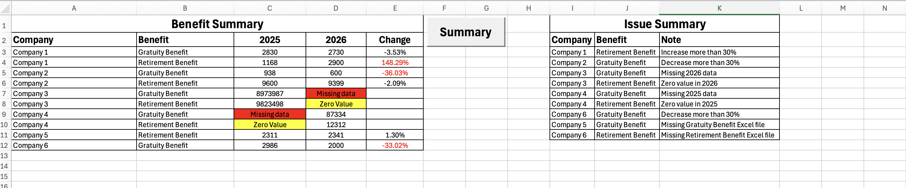

# Summary-Excel-Files-in-VBA

**Project Background**

Based on my experience from two actuarial co-op terms, I noticed that most of my work involved using Excel to calculate retirement benefit liabilities or insurance premiums. Another common task was comparing the results with the previous year's data.

Since these tasks were repetitive, I decided to create this VBA project to automatically summarize my work and give my employer a clear overview of the results without having to go through each Excel file manually.

  

**How it Works**

Assume all the companies or product has their folder and all stored in one main file:

The project assumes that each company or insurance product has its own folder, and all these folders are stored within one main directory.

The VBA code automatically loops through each folder, opens the Excel files, extracts the data, and combines everything into a single summary worksheet.

The VBA code also extract last year data and automatically calculate the year-over-year changes.

To make potential issues easier to spot, I also added conditional formatting:

**Red text**: Highlights percentage changes greater than 30% in either direction.

**Yellow cell**: Indicates that a value is zero.

**Red cell**: Indicates that data is missing.

  

**Issue Summary**

Furthermore, the VBA will create an issue summary that list 7 types of error. 
1. data is 30% more than last year
2. data is 30% less than last year
3. the value in 2026 is 0
4. the value in 2025 is 0
5. the value in 2026 is missing
6. the value in 2025 is missing
7. the file does not exist in the folder. 

Instead of checking each file manually, users can look at the Issue Summary to quickly identify which companies or products may need further review.

  

**Project Purpose**

I designed this project to serve as both a final work summary and a tool for tracking my own progress.

Once the work is completed, the summary gives other employees a clear overview of the results and highlights anything that may need further attention.

I can also run the tool at any point during my work to check what has been completed and what is still missing. This makes it easier to keep track of my progress without having to open and check every Excel file manually.

  

**Future Applications**

Although I built this project based on my two co-op experience, the VBA code is designed as a basic framework that can be adapted to other tasks.

As long as the files are stored in an organized and consistent folder structure, I can modify the code and still generate summaries.

My goal was not just to automate one particular process, but to create something reusable that I could build on in the future.

